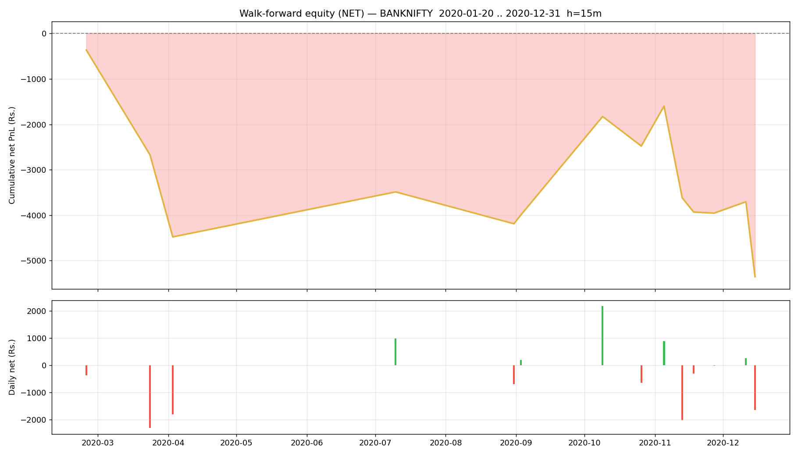

# Walk-forward report — BANKNIFTY

- Generated : 2026-11-25 00:35
- Test span : 2020-01-20 → 2020-12-31 (239 days, 183 skipped by no-edge rule)
- Train window : 13d (fit 8d + cal 5d), retrain every 1d
- Horizon 15m | deadband 0.1% | max hold 30 bars
- Calibrated: True | threshold: auto [0.65, 0.7, 0.75, 0.8] | exit 0.45 | skip-no-edge: True

## Results (net of all costs)
```
  Trades                : 29  over 14 days
  Win rate              : 48.3%
  Gross PnL             : Rs.-3,543
  Charges               : Rs.1,810
  NET PnL               : Rs.-5,353
  Expectancy / trade    : Rs.-184.6
  Avg win / loss        : Rs.494 / Rs.-818
  Profit factor         : 0.56
  Avg hold              : 19.1 bars
  Max drawdown          : Rs.4,988
  Best / worst day      : Rs.2,170 / Rs.-2,307
  Sharpe (daily, ann.)  : -4.77
  Sortino (daily, ann.) : -7.14

```

## By option type
```
             count          sum
option_type                    
CE              19  -806.688537
PE              10 -4546.723942
```

## By exit reason
```
             count         mean          sum
exit_reason                                 
signal          15  -157.209629 -2358.144433
stop             1 -2762.639266 -2762.639266
target           3   465.103458  1395.310373
time            10  -162.793915 -1627.939153
```

## By position size (lots)
```
      count          sum
lots                    
1        29 -5353.412479
```

## By chosen entry threshold
```
                 count          sum
entry_threshold                    
0.65                14 -4082.811464
0.70                10  -170.124610
0.75                 2 -1351.000250
0.80                 3   250.523845
```

## Monthly net PnL
```
exit_time
2020-02-29    -365.855628
2020-03-31   -2306.617647
2020-04-30   -1805.409729
2020-05-31       0.000000
2020-06-30       0.000000
2020-07-31     990.375753
2020-08-31    -701.219619
2020-09-30     190.279720
2020-10-31    1520.467233
2020-11-30   -1477.275519
2020-12-31   -1398.157043
Freq: ME
```

