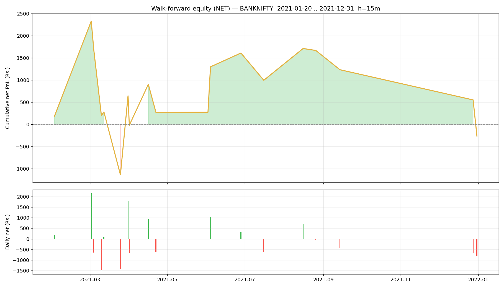

# Walk-forward report — BANKNIFTY

- Generated : 2026-11-25 00:54
- Test span : 2021-01-20 → 2021-12-31 (235 days, 168 skipped by no-edge rule)
- Train window : 13d (fit 8d + cal 5d), retrain every 1d
- Horizon 15m | deadband 0.1% | max hold 30 bars
- Calibrated: True | threshold: auto [0.65, 0.7, 0.75, 0.8] | exit 0.45 | skip-no-edge: True

## Results (net of all costs)
```
  Trades                : 40  over 19 days
  Win rate              : 45.0%
  Gross PnL             : Rs.2,028
  Charges               : Rs.2,292
  NET PnL               : Rs.-264
  Expectancy / trade    : Rs.-6.6
  Avg win / loss        : Rs.496 / Rs.-418
  Profit factor         : 0.97
  Avg hold              : 14.6 bars
  Max drawdown          : Rs.3,465
  Best / worst day      : Rs.2,146 / Rs.-1,481
  Sharpe (daily, ann.)  : -0.22
  Sortino (daily, ann.) : -0.52

```

## By option type
```
             count          sum
option_type                    
CE              13  1115.860394
PE              27 -1379.757476
```

## By exit reason
```
             count         mean          sum
exit_reason                                 
signal          27   199.189198  5378.108344
stop             4  -715.420586 -2861.682344
target           1  1810.743449  1810.743449
time             8  -573.883316 -4591.066531
```

## By position size (lots)
```
      count         sum
lots                   
1        40 -263.897083
```

## By chosen entry threshold
```
                 count          sum
entry_threshold                    
0.65                24  -119.297408
0.70                 5   805.937679
0.75                 7 -1298.016957
0.80                 4   347.479603
```

## Monthly net PnL
```
exit_time
2021-02-28     180.944032
2021-03-31     460.655347
2021-04-30    -373.663035
2021-05-31       0.000000
2021-06-30    1339.551428
2021-07-31    -614.536796
2021-08-31     672.489286
2021-09-30    -434.261247
2021-10-31       0.000000
2021-11-30       0.000000
2021-12-31   -1495.076098
Freq: ME
```

