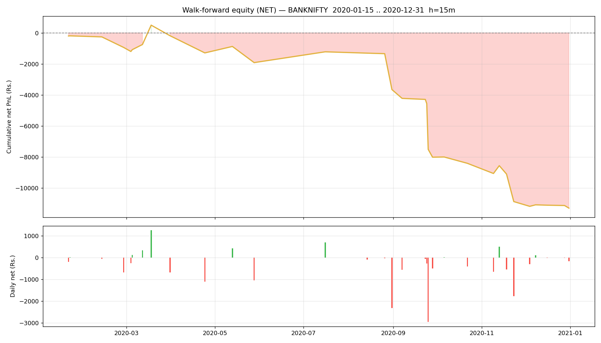

# Walk-forward report — BANKNIFTY

- Generated : 2026-11-25 01:06
- Test span : 2020-01-15 → 2020-12-31 (242 days, 180 skipped by no-edge rule)
- Train window : 10d (fit 8d + cal 2d), retrain every 1d
- Horizon 15m | deadband 1.5% | max hold 30 bars
- Calibrated: True | threshold: auto [0.65, 0.7, 0.75, 0.8] | exit 0.45 | skip-no-edge: True

## Results (net of all costs)
```
  Trades                : 77  over 32 days
  Win rate              : 39.0%
  Gross PnL             : Rs.-7,044
  Charges               : Rs.4,252
  NET PnL               : Rs.-11,296
  Expectancy / trade    : Rs.-146.7
  Avg win / loss        : Rs.238 / Rs.-392
  Profit factor         : 0.39
  Avg hold              : 7.7 bars
  Max drawdown          : Rs.11,791
  Best / worst day      : Rs.1,247 / Rs.-2,948
  Sharpe (daily, ann.)  : -6.84
  Sortino (daily, ann.) : -7.35

```

## By option type
```
             count          sum
option_type                    
CE              46 -7722.033695
PE              31 -3573.718039
```

## By exit reason
```
             count         mean          sum
exit_reason                                 
signal          63   -86.323670 -5438.391203
stop             2 -1456.747941 -2913.495882
target           4   530.671218  2122.684873
time             8  -633.318690 -5066.549521
```

## By position size (lots)
```
      count           sum
lots                     
1        77 -11295.751733
```

## By chosen entry threshold
```
                 count          sum
entry_threshold                    
0.65                21 -2071.584953
0.70                14 -2318.643897
0.75                17  -551.108608
0.80                25 -6354.414275
```

## Monthly net PnL
```
exit_time
2020-01-31    -193.542150
2020-02-29    -746.171076
2020-03-31     753.734194
2020-04-30   -1107.379220
2020-05-31    -625.468197
2020-06-30       0.000000
2020-07-31     696.617402
2020-08-31   -2434.733498
2020-09-30   -4357.848826
2020-10-31    -394.093984
2020-11-30   -2465.711592
2020-12-31    -421.154785
Freq: ME
```

