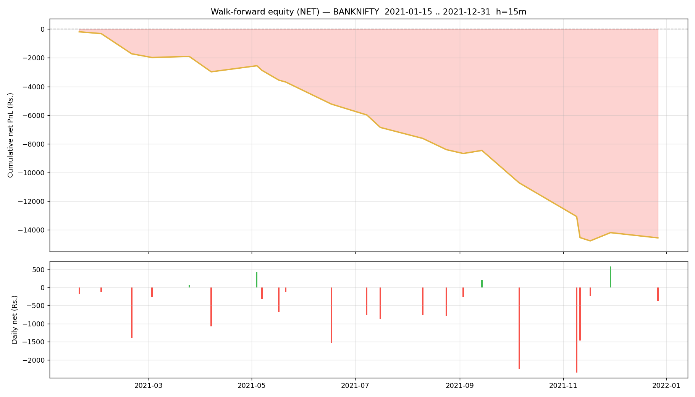

# Walk-forward report — BANKNIFTY

- Generated : 2026-11-25 01:20
- Test span : 2021-01-15 → 2021-12-31 (238 days, 190 skipped by no-edge rule)
- Train window : 10d (fit 8d + cal 2d), retrain every 1d
- Horizon 15m | deadband 1.5% | max hold 30 bars
- Calibrated: True | threshold: auto [0.65, 0.7, 0.75, 0.8] | exit 0.45 | skip-no-edge: True

## Results (net of all costs)
```
  Trades                : 84  over 23 days
  Win rate              : 28.6%
  Gross PnL             : Rs.-9,780
  Charges               : Rs.4,775
  NET PnL               : Rs.-14,556
  Expectancy / trade    : Rs.-173.3
  Avg win / loss        : Rs.305 / Rs.-365
  Profit factor         : 0.33
  Avg hold              : 9.2 bars
  Max drawdown          : Rs.14,578
  Best / worst day      : Rs.575 / Rs.-2,349
  Sharpe (daily, ann.)  : -13.01
  Sortino (daily, ann.) : -14.57

```

## By option type
```
             count         sum
option_type                   
CE              32 -9037.40658
PE              52 -5518.11202
```

## By exit reason
```
             count        mean          sum
exit_reason                                
eod              1 -105.408795  -105.408795
signal          68  -91.820833 -6243.816615
stop             6 -989.862447 -5939.174683
target           2  931.668347  1863.336695
time             7 -590.065029 -4130.455202
```

## By position size (lots)
```
      count         sum
lots                   
1        84 -14555.5186
```

## By chosen entry threshold
```
                 count          sum
entry_threshold                    
0.65                34 -7700.491953
0.70                37 -4889.697847
0.80                13 -1965.328800
```

## Monthly net PnL
```
exit_time
2021-01-31    -187.129987
2021-02-28   -1532.150010
2021-03-31    -182.486282
2021-04-30   -1074.091731
2021-05-31    -710.870384
2021-06-30   -1539.585022
2021-07-31   -1630.244068
2021-08-31   -1547.091112
2021-09-30     -55.514913
2021-10-31   -2257.890909
2021-11-30   -3473.650738
2021-12-31    -364.813445
Freq: ME
```

