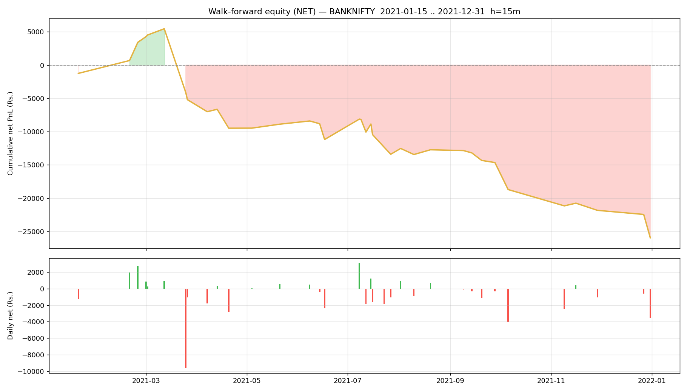

# Walk-forward report — BANKNIFTY

- Generated : 2026-11-25 01:37
- Test span : 2021-01-15 → 2021-12-31 (238 days, 165 skipped by no-edge rule)
- Train window : 10d (fit 8d + cal 2d), retrain every 1d
- Horizon 15m | deadband 0.1% | max hold 30 bars
- Calibrated: True | threshold: auto [0.65, 0.7, 0.75, 0.8] | exit 0.45 | skip-no-edge: True

## Results (net of all costs)
```
  Trades                : 154  over 36 days
  Win rate              : 43.5%
  Gross PnL             : Rs.-17,066
  Charges               : Rs.8,912
  NET PnL               : Rs.-25,978
  Expectancy / trade    : Rs.-168.7
  Avg win / loss        : Rs.370 / Rs.-583
  Profit factor         : 0.49
  Avg hold              : 12.6 bars
  Max drawdown          : Rs.31,438
  Best / worst day      : Rs.3,065 / Rs.-9,583
  Sharpe (daily, ann.)  : -5.22
  Sortino (daily, ann.) : -5.62

```

## By option type
```
             count           sum
option_type                     
CE              71 -14539.894599
PE              83 -11438.226598
```

## By exit reason
```
             count        mean           sum
exit_reason                                 
eod              1  -32.757691    -32.757691
signal         117    1.355579    158.602769
time            36 -725.110174 -26103.966275
```

## By position size (lots)
```
      count           sum
lots                     
1       154 -25978.121197
```

## By chosen entry threshold
```
                 count           sum
entry_threshold                     
0.65                93  -9057.263312
0.70                25  -2841.189338
0.75                22 -14183.978525
0.80                14    104.309978
```

## Monthly net PnL
```
exit_time
2021-01-31   -1251.839983
2021-02-28    4672.250038
2021-03-31   -8622.571641
2021-04-30   -4290.262366
2021-05-31     607.905932
2021-06-30   -2306.907929
2021-07-31   -2220.146103
2021-08-31     675.567578
2021-09-30   -1921.525303
2021-10-31   -4060.060976
2021-11-30   -3126.271755
2021-12-31   -4134.258689
Freq: ME
```

