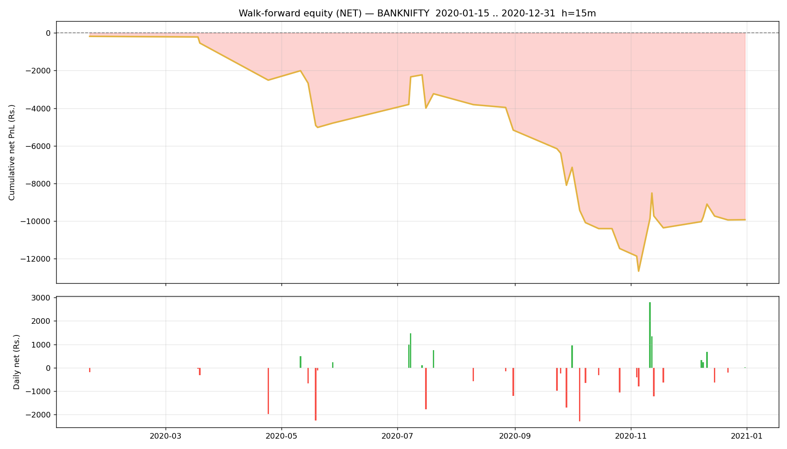

# Walk-forward report — BANKNIFTY

- Generated : 2026-11-25 01:52
- Test span : 2020-01-15 → 2020-12-31 (242 days, 174 skipped by no-edge rule)
- Train window : 10d (fit 8d + cal 2d), retrain every 1d
- Horizon 15m | deadband 0.1% | max hold 30 bars
- Calibrated: True | threshold: auto [0.65, 0.7, 0.75, 0.8] | exit 0.45 | skip-no-edge: True

## Results (net of all costs)
```
  Trades                : 94  over 38 days
  Win rate              : 46.8%
  Gross PnL             : Rs.-4,529
  Charges               : Rs.5,399
  NET PnL               : Rs.-9,928
  Expectancy / trade    : Rs.-105.6
  Avg win / loss        : Rs.428 / Rs.-576
  Profit factor         : 0.65
  Avg hold              : 16.7 bars
  Max drawdown          : Rs.12,476
  Best / worst day      : Rs.2,804 / Rs.-2,286
  Sharpe (daily, ann.)  : -3.94
  Sortino (daily, ann.) : -5.92

```

## By option type
```
             count           sum
option_type                     
CE              55   1238.075192
PE              39 -11166.549997
```

## By exit reason
```
             count        mean           sum
exit_reason                                 
eod              1 -276.260236   -276.260236
signal          52  -69.695898  -3624.186715
target          11  584.467378   6429.141161
time            30 -415.238967 -12457.169015
```

## By position size (lots)
```
      count          sum
lots                    
1        94 -9928.474805
```

## By chosen entry threshold
```
                 count          sum
entry_threshold                    
0.65                43  3191.193879
0.70                26 -6868.985081
0.75                 6 -3129.551920
0.80                19 -3121.131683
```

## Monthly net PnL
```
exit_time
2020-01-31    -184.369309
2020-02-29       0.000000
2020-03-31    -356.934031
2020-04-30   -1970.102299
2020-05-31   -2282.190927
2020-06-30       0.000000
2020-07-31    1559.589718
2020-08-31   -1932.524435
2020-09-30   -2929.749609
2020-10-31   -3360.886918
2020-11-30    1098.165268
2020-12-31     430.527737
Freq: ME
```

