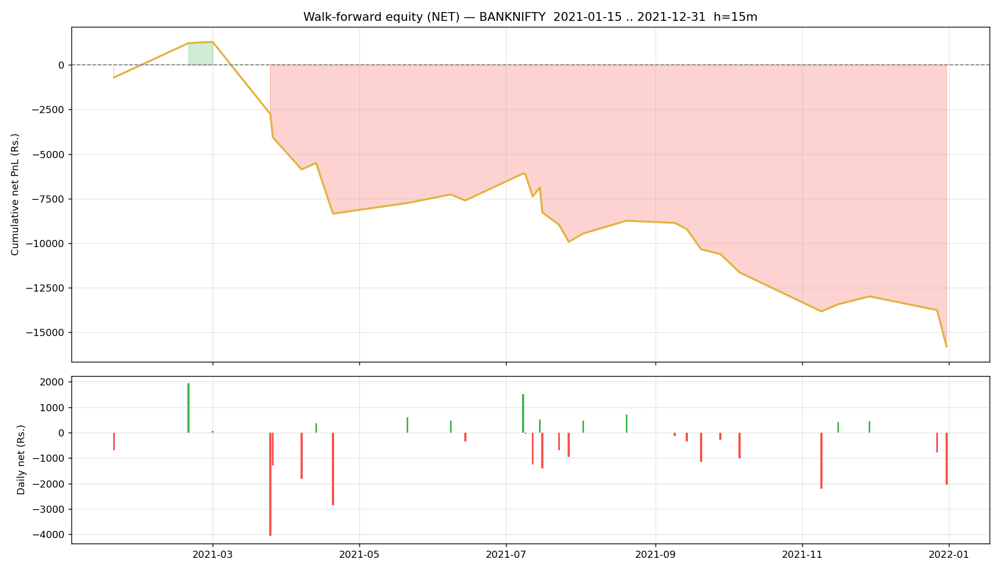

# Walk-forward report — BANKNIFTY

- Generated : 2026-11-25 02:08
- Test span : 2021-01-15 → 2021-12-31 (238 days, 171 skipped by no-edge rule)
- Train window : 10d (fit 8d + cal 2d), retrain every 1d
- Horizon 15m | deadband 0.1% | max hold 30 bars
- Calibrated: True | threshold: auto [0.65, 0.7, 0.75, 0.8] | exit 0.45 | skip-no-edge: True

## Results (net of all costs)
```
  Trades                : 101  over 30 days
  Win rate              : 44.6%
  Gross PnL             : Rs.-9,962
  Charges               : Rs.5,845
  NET PnL               : Rs.-15,808
  Expectancy / trade    : Rs.-156.5
  Avg win / loss        : Rs.371 / Rs.-581
  Profit factor         : 0.51
  Avg hold              : 13.1 bars
  Max drawdown          : Rs.17,107
  Best / worst day      : Rs.1,933 / Rs.-4,055
  Sharpe (daily, ann.)  : -6.57
  Sortino (daily, ann.) : -8.24

```

## By option type
```
             count           sum
option_type                     
CE              50 -10542.650376
PE              51  -5265.148708
```

## By exit reason
```
             count         mean           sum
exit_reason                                  
signal          71   -25.280396  -1794.908104
target           5  1179.927598   5899.637990
time            25  -796.501159 -19912.528970
```

## By position size (lots)
```
      count           sum
lots                     
1       101 -15807.799084
```

## By chosen entry threshold
```
                 count          sum
entry_threshold                    
0.65                69 -5591.028474
0.70                13 -5002.793559
0.75                 8 -1307.243335
0.80                11 -3906.733716
```

## Monthly net PnL
```
exit_time
2021-01-31    -700.581015
2021-02-28    1932.839902
2021-03-31   -5289.684985
2021-04-30   -4290.262366
2021-05-31     598.549248
2021-06-30     138.694311
2021-07-31   -2320.692299
2021-08-31    1184.776384
2021-09-30   -1878.043287
2021-10-31   -1024.730975
2021-11-30   -1346.105637
2021-12-31   -2812.558365
Freq: ME
```

